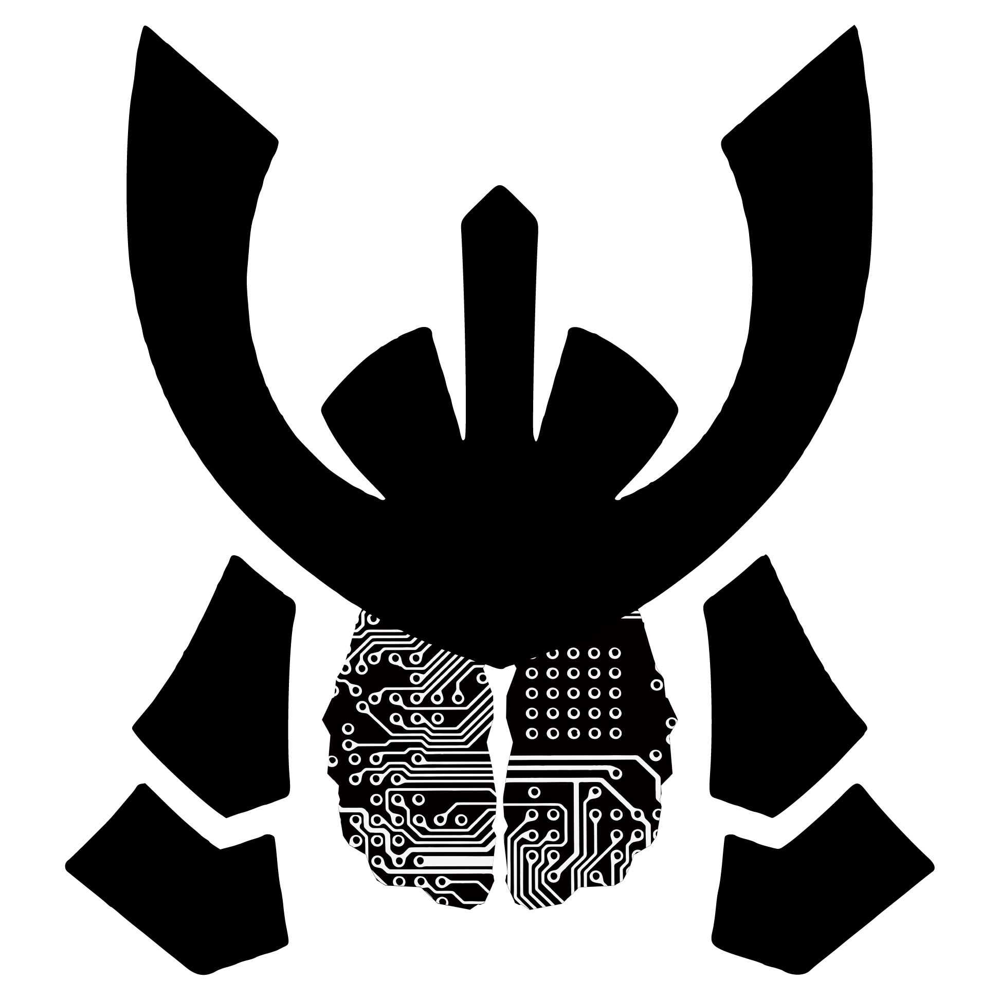

# SAMURAI (**S**egment **A**nything **M**odel **U**tilized for **R**adiomic **A**nalysis of **I**mages)
<br>
<p align="center">



## Introduction

Our abstract:
> *Machine Learning Segmentation of Magnetic Resonance Images for Radiomics of Traumatic Brain Injury Hematomata*, Neurotrauma 2025 (Philadelphia, PA)

Adaptation of SAM2 for segmentation of brain hematomas.

**NOTE:** This software is not intended for clinical use.

## System requirements

### Minimum requirements
```
16 GB RAM
300 GB Disk Space
10 Cores
macOS or Windows 11
```

### Recommended requirements
```
36 GB RAM
1 TB Disk Space
14 Cores
macOS
```

## Installation

For macOS:
```bash
python -m venv ./venvs/venv_SAMURAI/ && source ./venvs/venv_SAMURAI/bin/activate && git clone https://github.com/ilhanbok/SAMURAI.git && cd SAMURAI && ./install_SAMURAI.sh && cd scripts
```

For Windows:<br><br>
First install Anaconda: https://www.anaconda.com/download<br><br>
Then run the following in Anaconda Powershell:
```bash
python -m venv ./venvs/venv_SAMURAI/
source ./venvs/venv_SAMURAI/bin/activate
git clone https://github.com/ilhanbok/SAMURAI.git
cd SAMURAI
./install_SAMURAI.ps1
cd scripts
```

This should take about 5 minutes

Example open-access nifti files are here:
https://github.com/neurolabusc/niivue-images.git

For both:
```bash
git clone https://github.com/neurolabusc/niivue-images.git
cd scripts
```

## Usage

There are two modes of operation: (i) Manual (GUI-based) selection and (ii) threshold-based lesion identification.

For DICOM files use a conversion tool such as [dcm2niix](https://github.com/rordenlab/dcm2niix) to create input NIFTI file.

Before execution, ensure all pip and anaconda environments are deactivated.

First run:
(macOS)
`source ./venvs/venv_SAMURAI/bin/activate`<br>
Or (Windows 11)
`conda activate venv_SAMURAI`

To use mode (i);
- Run:
`python Adjunct_SAM_lesion_threshAndFilter_wrapper_01232025.py ../niivue-images/chris_t1.nii.gz` or your nifti file of choice<br>
- Use the scroll wheel to select the appropriate slice on any axis (sagittal, coronal, or axial) and click 'Si'
- Click on the points within the frame which you believe to be either intra-lesional (fg:1) or extra-lesional (bg:0).
- Enter the number of intra- and extra-lesional points. e.g. `4 2`
- Segmentation will proceed automatically
- The final mask will be displayed and can be edited as desired
- The segmented landmark will be saved to `scripts/output_SAMURAI.nii.gz`
- Time splits for each step will be saved to 'scripts/times_SAMURAI.txt`

Video tutorial:<br>
https://www.youtube.com/watch?v=8VA3K332Exo

To use mode (ii):
- Usage: `python thresholdSAM_01062025.py NIFTI_PATH output_csv(.csv) mode(QSM or RAW) threshold(e.g.400) flip(lesions are dark? [0/1]) blur(gaussian blur σ to hide artifacts? [0/1]) skullstrip(strip skull or not? [0/1])`
- For example: `python thresholdSAM_01062025.py ../niivue-images/chris_t1.nii.gz chris_t1 RAW 100 1 0 0`
- After iterating over possible lesions, you have the option to inspect and Accept (`Si`) each lesion or not.
- As for mode (i), there will be a pop-up point selection window to add additional foreground / background points before a final confirmation dialog
- Each lesion has a unique identification number which will be appended to its output NIFTI file. These files can be merged and viewed as a final .nii mask.

## About/Contact Information

Patrick Belton (belton@neurosurgery.wisc.edu)<br>
Ilhan Bok (ibok@wisc.edu)

Department of Neurological Surgery<br>
School of Medicine and Public Health<br>
University of Wisconsin - Madison
