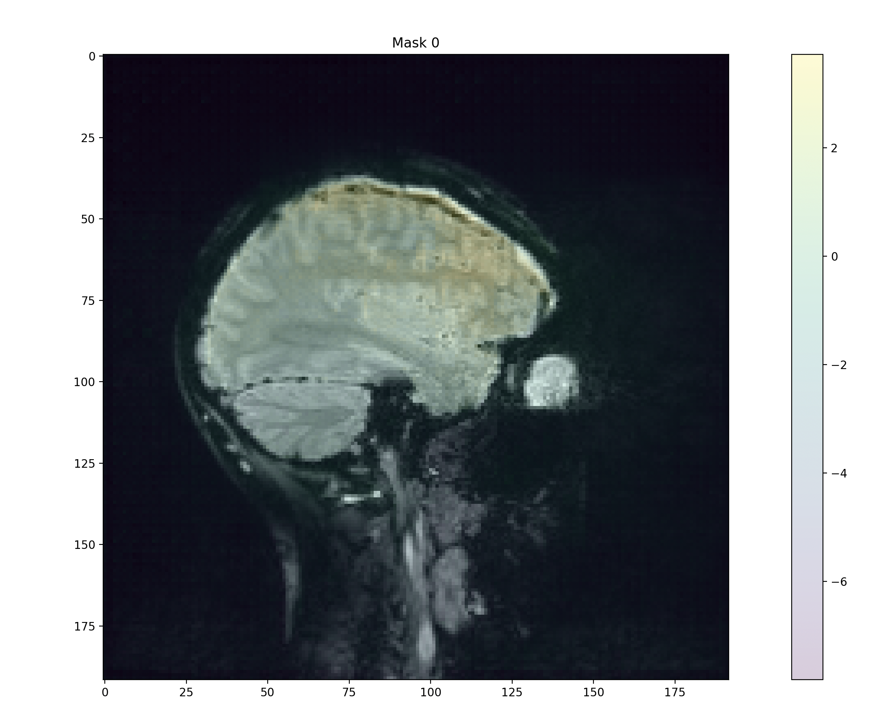
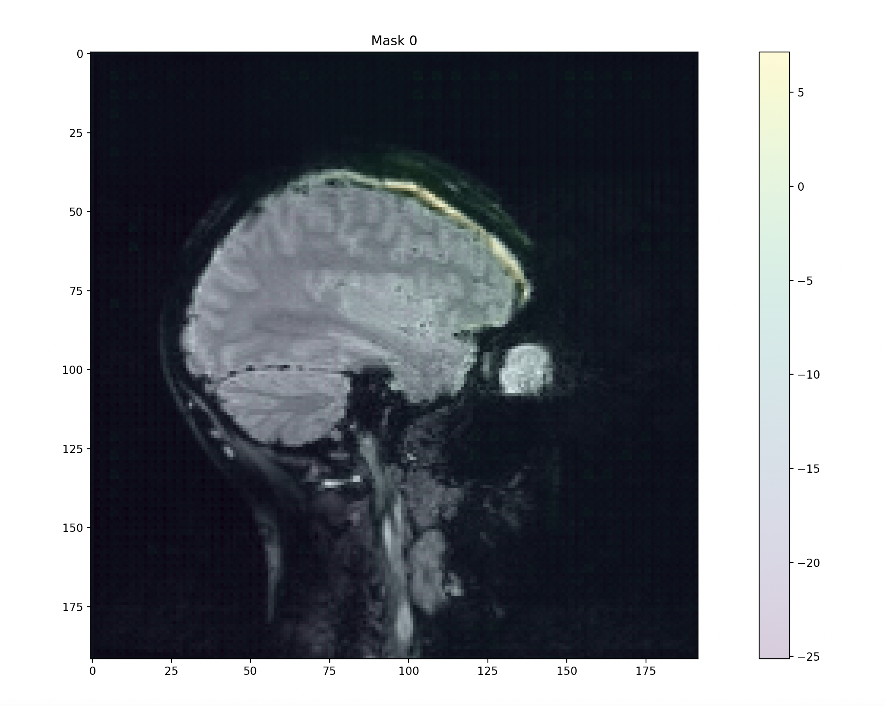

# SAMURAI Workflow - Standard Operating Protocol <br>

## Overview

SAMURAI output is well structured but may require slight adjustments in order
to best represent the lesions being segmented. This methods section details
additional techniques we have used to curate masks produced by SAMURAI. The workflow for SAMURAI beginning with the interactive terminal-based GUI has been carefully curated to ensure productive, high-quality segmentation masks that can be used in a 'plug-and-play' manner to construct cohesive, well-built final masks.

Specifically,
careful curation and combination of a comprehensive segmentation session can
preserve the work performed by SAMURAI while improving UI. It is advisable to note that SAMURAI is a tool rather than an expert radiologist and it is recommended that the user apply common sense and careful discretion, including advice from an expert radiologist before interpreting SAMURAI's output.

## Selection of points for mask generation

Be sure to iteratively point out regions that have been mis-segmented to SAMURAI. E.g. shown below, IP was selected and allowed SAMURAI to refine prediction.

|  |   |
|-|-|

## Protocol for processing segmentation output

1. Collect relevant output files
2. Inspect output files in advance
3. Run `Utilities.py` for file curation
4. Perform additional hand curation
5. Prepare files for data analyses

## 1. Collect relevant output files
Files created by SAMURAI can be stored within a nested working directory.
Use the following to create a storage folder:
```
cd scripts
mkdir -p combined_lesions/completed_subjects
```
After confirming SAMURAI output, output will be stored in one of two forms:

### Mode (i)
Usage of output from `Adjunct_SAM_lesion_threshAndFilter_wrapper_01232025.py` or
`Adjunct_SAM_lesion_threshAndFilter_wrapper_BoundingBox_01232025.py`:

```
SAMURAI
├–––scripts
│   ├–––output_SAMURAI_[yyyymmdd-hhmmss].nii.gz
│   ├–––times_SAMURAI_[yyyymmdd-hhmmss].txt
...
```
`mv output*.nii.gz combined_lesions/`

The scripts directory for SAMURAI will comprise a NIFTI file containing a fresh
segmentation mask and a text file comprising the times SAMURAI taken on each step.
Each file will have a suffix with a unique timestamp that can be used to identify
a particular segmentation session.

**Bounding Box Output:**
While using the "bounding box" version of the above script (i.e. SAMURAI-BB), be sure to select
a sufficient amount of the image surrounding the region of interest without
overfocusing on the precise extent of the lesion.
- SAMURAI-BB can be applied to lesions that are already clearly demarcated to further improve prediction confidence.

Output from SAMURAI-BB is in the same format as SAMURAI used without a bounding box.
Note that lesions segmented using other techniques (manual, contour-based, convolutional
neural network, etc.) may also be combined into these folders.

An alternative to bounding box usage is cropping the image before segmentation and
assembling an appropriate full mask afterwards.

### Mode (ii)
Usage of output from `thresholdSAM_01062025.py`:
```
SAMURAI
├–––scripts
│    ├–––[csv_name]_lesionnum_<n1>.nii.gz
│    ├–––[csv_name]_lesionnum_<n2>.nii.gz
│    ├–––[csv_name]_lesionnum_<n3>.nii.gz
│    ├–––[csv_name].csv
...
```
`mv *lesionnum*.nii.gz combined_lesions/`

The scripts directory will comprise a series of NIFTI files where each file represents
one lesion/cluster. A summary CSV file will also be generated that contains a list of all identified regions in the below format:

| COMs_x    | COMs_y |COMs_z|volumes
| -------- | ------- |------|-------
| 1.25  | 6.676    |2.34  | 5.50
| 1.57| 8.98    |2.45 | 5.51
| ...   | ...    | ... | ...

With row count corresponding to lesion number.

### General instructions

In either case filenames are permuted with unique identifier substrings so
it may be efficient to run several instances of SAMURAI at once either using
different regions of the same MRI scan or several subjects simultaneously.
When using mode (ii) be sure to use a unique `csv_name` for each time the
script is invoked. If there is inadequate time to assemble and curate all segmentation masks, the user should take advantage of this system and carefully catalog all output before applying changes at a later time.

## 2. Inspect output files in advance
Continue by inspecting all output files in order to
ensure segmentation integrity. While SAMURAI has built-in final segmentation viewing capability before confirmation, any MRI image viewer can be used to inspect SAMURAI output. For example, [ITK-SNAP](http://www.itksnap.org/pmwiki/pmwiki.php?n=Main.HomePage) is an excellent tool for accurate voxel-level inspection while [Flywheel](https://flywheel.io/) is better suited for whole-image level interpretation. Load the original MRI image as a base layer then open SAMURAI output as an overlay or segmentation.

SAMURAI is adept at capturing edges, transition regions, and gradients which greatly facilitates
segmentation along a single axis. However, we recommend viewing images and making incremental adjustments in all three cardinal planes (axial, sagittal, and coronal) for the best possible segmentation final result.

After inspection, masks can be trimmed and adjusted in conjunction either with the Python suite below or using a NIFTI viewer.

## 3. Run Python helper script (Utilities.py) for file curation

Files are stored in the base directory, subfolder `scripts` as `.nii.gz`
(compressed NIFTI) format. Lesion masks can be modified using `Utilities.py`.

The following methods can be used to combine selected files into finalized
holistic masks. Final confirmed results should be moved into a separate folder for additional
modification. These scripts can be especially helpful for patients with an exceedingly large number of
microhemorrhages that are difficult to combine manually or using a NIFTI editor
GUI.

For example:
```
cd scripts
mkdir combined_lesions
mv *.nii.gz combined_lesions
```

Ensure that all files in `combined_lesions` (or your folder
of choice) are all intended for one mask before running the following adjustments.
 Note that you should use `MERGE.py` before using `ZERO.py` to improve workflow efficiency.

You may also run SAMURAI multiple times to generate more masks for aggregation.
The following Python scripts are intended to help with editing NIFTI files
produced by SAMURAI.

`Utilities.py` has multiple options both for image modification and statistical
processing once SAMURAI has completed segmentation. We have created this plug-and-play
Python module to facilitate UX and simplifying post-segmentation workflow. To use
`Utilities.py`, adhere to the following syntax:
`python Utilities.py <Program Option> [parameter 1] [parameter 2] [parameter 3] ... [parameter n]`

This consolidated toolkit can be incorporated into large-scale batch scripts or automation pipelines in order to further facilitate analysis using SAMURAI.

Image modification options for `Utilities.py` are described below (optional parameters are in parentheses):

1. `MERGE`
- Prerequisites: Ensure that NIFTI files all belong to the same subject and
have been placed in the same folder `input_dir`
- Description: Combine multiple NIFTI files into a single NIFTI file.
- Usage:
`python Utilities.py MERGE input_dir output_file`
- Example:
`python Utilities.py MERGE combined_lesions subject_<m>.nii.gz`
- Output: A NIFTI file containing a logical union of all input files

2. `ZERO`
- Prerequisites: Have the NIFTI file and slice indices ready. ITK-SNAP can
be used to inspect the file and determine slices to clear before script usage.
- Description:
Used to delete slices within a range for spurious segmentation output.
- Usage:
`python Utilities.py ZERO input_file output_file slice_start slice_finish (axis)`
- Example:
`python Utilities.py ZERO subject_<m>.nii.gz subject_<m>_zeroed.nii.gz 1 14 0`
- Output: A new NIFTI file with superfluous segmentation masks removed

3. `DUPLICATE`
- Prerequisites: Have the slice indices ready for input. ITK-SNAP can
be used to inspect the file and determine which slice to duplicate and which
layer to duplicate to before script usage.
- Description:
Used to duplicate a slice from one layer to another within an input NIFTI
- Usage:
`python Utilities.py DUPLICATE input_file output_file slice_source slice_destination`
- Example:`python Utilities.py DUPLICATE subject_<m>.nii.gz subject_<m>_cloned.nii.gz 13 14`
- Output: A new NIFTI file with requested changes made

Final segmentation results can be moved to `scripts/combined_lesions/completed_subjects`
for storage. Retain separate folders with corresponding subject or scan ID to expedite
further analyses.

## 4. Perform additional hand curation

Using the output of SAMURAI can feel unfamiliar at an initial encounter because of
the behavior within and across slices. SAMURAI is good at identifying hematoma/hemorrhage boundaries but may be
overzealous, segmenting healthy tissue surrounding the lesion. Be sure to outline and remove segmented areas around the lesion using the freehand polygon tool from
the final segmentation mask. Voxel-by-voxel painting can be used to adjust
segmented boundaries or include tiny hematomas based on user discretion. In order to ensure that
boundaries are well-preserved through slices, it is important to try and respect the output of SAMURAI
before applying drastic changes to the segmentation mask.

## 5. Prepare files for data analyses

Several additional helpful scripts are provided for the purpose of comparing Segmentation
results across multiple users and/or sessions. Information on these scripts is detailed below:

1. `IRV`
- Prerequisites: Ensure that each pair of files used for this script in each directory
have the same name
- Description:
Used to determine inter-rater variability (IRV) across a set of subjects.
- Usage:
`python Utilities.py IRV dir_1 dir_2`
- Example:
`python Utilities.py IRV IRV_Alice/ IRV_Bob/`
- Output: The inter-rater variability between each pair of subjects as well as
the average and standard deviation across the whole set of subjects. An IRV of IRV<0.5 is considered poor, 0.5<IRV<0.7 is good, and IRV>0.7 is excellent.

2. `VOLUME`
- Prerequisites: Ensure all files for analysis are placed in a single directory
- Description: Computes the volumes of NIFTI masks
- Usage:
`python Utilities.py VOLUME subject_folder output_csv`
- Example:
`python Utilities.py VOLUME find_volumes/ volumes.csv`
- Output: A list of estimated volumes for the subjects in the input directory
